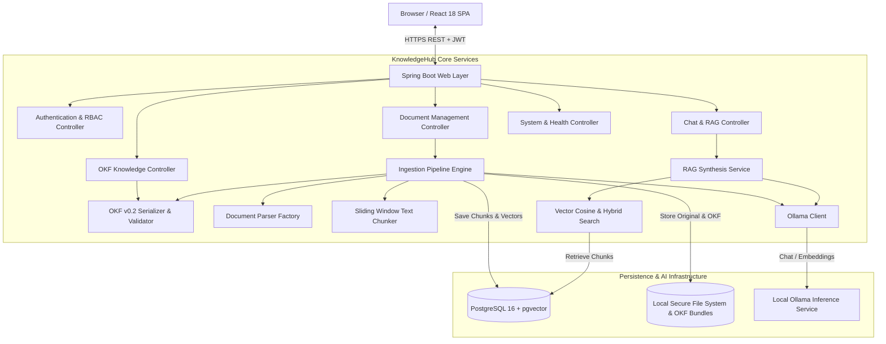
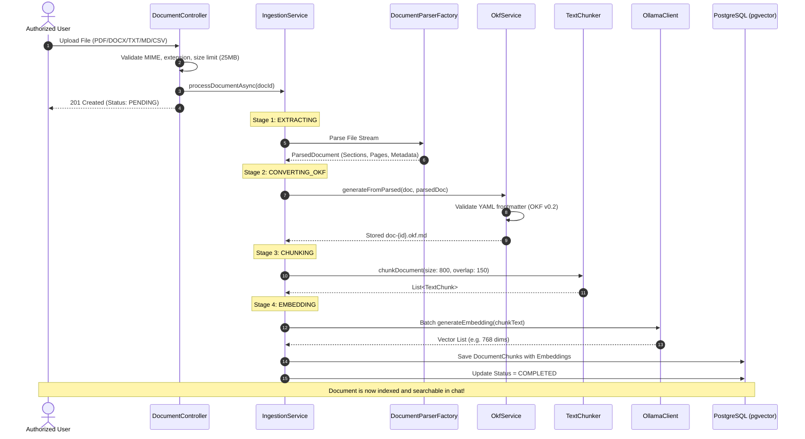
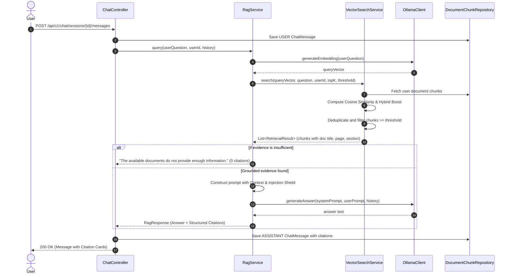
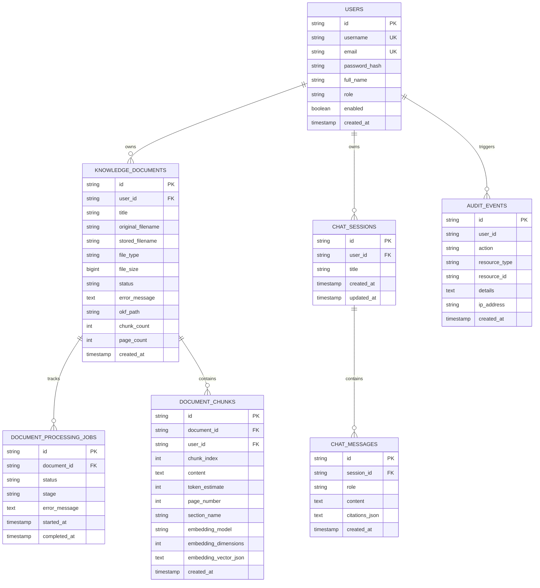

# KnowledgeHub AI - Architecture & System Design

KnowledgeHub AI is an enterprise knowledge assistant application designed for secure, self-hosted document ingestion, Open Knowledge Format (OKF v0.2) compliance, vector similarity search, and local Ollama RAG generation without reliance on external paid LLM APIs.

---

## 1. Overall System Architecture



---

## 2. Document Ingestion Pipeline



---

## 3. RAG Query Flow



---

## 4. Database Relationships (ER Diagram)



---

## 5. Deployment Topology

```mermaid
graph TD
    subgraph DockerHost [Docker Compose Environment]
        NGINX[Frontend Container (Port 3000 / Nginx)]
        SpringBoot[Backend Container (Port 8080 / Temurin 17 JRE)]
        PGVector[Database Container (Port 5432 / pgvector:pg16)]
        
        NGINX -->|Reverse Proxy /api| SpringBoot
        SpringBoot -->|JDBC Connection| PGVector
    end
    
    subgraph LocalAI [Local Host Machine]
        HostOllama[Ollama Inference Engine (Port 11434)]
    end
    
    SpringBoot -->|HTTP API calls / host.docker.internal| HostOllama
    User([User Browser]) -->|HTTP :3000| NGINX
```
